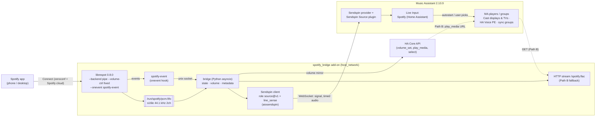

# Spotify Bridge: Implementation Plan

Companion to [DECISIONS.md](DECISIONS.md). The decision IDs (D1–D8) and risk IDs (R1–R8) refer to that document.
Date: 2026-11-12

## Architecture



What happens during a session (Path A):

1. You pick **Home Assistant** in the Spotify app. librespot starts a session, then fires `playing` and writes PCM to the FIFO.
2. The bridge reports `client/state source.signal = present`. MA's Sendspin Source plugin auto-starts the Live Input on its configured target and sends `server/command: start`.
3. The bridge streams timestamped PCM through `SourceCapture.feed()`. It drains and drops PCM while MA has not asked for audio, so librespot never blocks.
4. Spotify volume changes go to `media_player.volume_set` on the MA player that is playing the source (D6).
5. `paused`/`stopped` → `signal = absent`. MA keeps playing silence and stops the player after 1 min. Switching device in Spotify (`session_client_changed`/`session_disconnected`) does the same.

## Repository layout (target)

The upstream files keep their place, so upstream merges stay clean. Our additions are in **bold**.

```
ha-spotify-bridge/
├── **repository.yaml**                 # makes the repo installable as an HA add-on repository
├── README.md                           # rewritten: what the fork is, credit to upstream
├── **docs/** DECISIONS.md, PLAN.md, TESTING.md
├── spotify/  → renamed **spotify_bridge/**   (git mv, so history follows)
│   ├── config.yaml                     # slug spotify_bridge, homeassistant_api, no audio, new options
│   ├── build.yaml                      # unchanged base image
│   ├── Dockerfile                      # librespot features: native-tls with-libmdns (no pulse); + python3 venv
│   ├── DOCS.md / translations/en.yaml  # new options documented
│   └── rootfs/
│       ├── etc/services.d/librespot/run      # adds --backend pipe --device FIFO --format S16 --volume-ctrl fixed --onevent
│       ├── etc/services.d/librespot/finish   # unchanged
│   │   ├── **etc/cont-init.d/spotify-bridge.sh**  # creates /run/spotify-bridge/audio.fifo
│   │   └── **etc/services.d/bridge/{run,finish}**
│   └── **bridge/**                     # Python package (inside the add-on dir = Docker build context),
│       ├── pyproject.toml              #   installed into /opt/spotify-bridge (venv)
│       ├── src/spotify_bridge/
│       │   ├── __main__.py             # `spotify-bridge`: load /data/options.json, run
│       │   ├── app.py                  # wiring; Phase 2 hooks marked
│       │   ├── config.py
│       │   ├── event_hook.py           # `spotify-bridge-event` (librespot --onevent) → unix datagram
│       │   ├── events.py               # unix-socket server → state machine
│       │   ├── state.py                # idle / connected / playing / paused; signal_present
│       │   ├── pcm.py                  # real-time paced FIFO reader (back-pressure on librespot)
│       │   ├── sendspin_source.py      # Phase 2: aiosendspin client, source role, line_sense, /data
│       │   ├── http_stream.py          # Phase 3: Path B, aiohttp + ffmpeg FLAC fan-out
│       │   └── ha.py                   # Phase 3: Supervisor → Core API (volume_set, play_media)
│       └── tests/                      # pytest (Linux-only tests skip on Windows) + smoke_linux.py
└── spike/                              # Phase 0 Sendspin source spike (reference only)
```

## Phases

### Phase 0: Decide and de-risk (about 1 day, mostly hands-on in HA)

Goal: answer D1 and R1 before writing any code.

- [x] **R1, account check (PASS 2026-11-12, see TESTING.md):** start the *stock* Spotify Connect add-on for a moment and pick it in Spotify. The log must show a session and `playing` (audio goes nowhere, which is expected). Stop it again (start on boot stays off). If login fails, stop here: the answer is MA's plugin with Soloist.
- [ ] *(Optional, D1 is already decided)* Delay baseline: add MA's built-in **Spotify Connect** plugin with Connected players = Living Room Display, measure its delay, then remove it (R6).
- [x] **D2 spike (PASS 2026-11-12, see TESTING.md; delay not measured):** in a scratch Python venv on the PC, run an aiosendspin client with `source` + `line_sense`, feeding a test tone. Pair it in MA. Confirm it appears under Live Inputs and auto-starts on a chosen player when the signal goes `present`.
- [ ] Measure the end-to-end delay (click track) for the spike, and for MA's plugin as the baseline.
- [ ] Write the results in `docs/TESTING.md` and confirm or revise D1, D2 and D3.

**Exit criteria:** the account works with librespot, and the Sendspin source path is proven on this MA. (D1, D3, D5 and D8 were decided by the owner on 2026-11-12.)

### Phase 1: Fork and audio plumbing (about 2 days)

- [x] *(2026-11-12)* Fork on GitHub as `dnwk/ha-spotify-bridge` (public, D8). Clone it locally, add the `upstream` remote, and create the `bridge` branch. `git mv spotify spotify_bridge`. Add `repository.yaml`. Disable upstream's org-specific workflows.
- [x] Dockerfile: librespot features `native-tls with-libmdns` (no PulseAudio), python3 3.14 + venv + bridge package, `chmod a+x` safety net. `audio: true` removed from config.yaml. **Image not built yet.**
- [x] librespot `run`: `--backend pipe --device /run/spotify-bridge/audio.fifo --format S16 --volume-ctrl fixed --onevent … --emit-sink-events`. The FIFO is created in `cont-init.d` (before both services).
- [x] `spotify-bridge-event` hook + `events.py` + `state.py` state machine (idle / connected / playing / paused).
- [x] `pcm.py`: real-time paced reader (one 20 ms chunk per tick, O_RDWR so no EOF). Pipe back-pressure keeps librespot in real time.
- [x] Tests: 28 pass on Linux (WSL), 25 on Windows (3 Linux-only skipped), ruff clean. `tests/smoke_linux.py` ran the real bridge with a fake librespot: events → states → signal present/absent; 300 chunks = 6.0 s; the writer was paced to 5.65 s (0.37 s pipe buffer).
- [x] Image built locally for amd64 with Docker Desktop (2026-11-12, about 2.5 min, 145 MB). In-container check: librespot 0.8.0 has only the `pipe`/`subprocess` backends, no libpulse, and accepts all the run-script flags (`volume control: Fixed`, `StdoutSink (pipe) with format: S16`). The bridge received events through the real hook and paced 6.0 s of audio (writer took 5.64 s). Clean exit on SIGTERM.
- [x] Installed on the test HA from the GitHub repo (`#bridge`, built on the VM in 14.5 min) and ran it (2026-11-12).
- [x] **Demo (PASS 2026-11-12, see TESTING.md):** Spotify → "Home Assistant" → the bridge logged real-time PCM levels (250 chunks per 5 s), track changes, pause/resume and signal present/absent. One state-machine bug was fixed (`stopped` after a disconnect).

**Phase 1 complete.**

### Phase 2: Sendspin source into MA (about 3 days)

- [ ] `sendspin_source.py`: client hello with `source@v1` (PCM s16 44.1k stereo, FLAC optional), `line_sense: true`. Store the pairing and identity in `/data`. Reconnect with backoff.
- [ ] Map the state machine to `signal` present/absent. On `server/command: start`/`stop`, start or stop the capture. Feed timestamped PCM.
- [ ] Pairing instructions in DOCS.md. Option `sendspin_name`.
- [ ] Set the autostart target in MA (Living Room Display). Test moving the Live Input to another speaker and to a sync group by hand.
- [x] **Demo (PASS 2026-11-12, see TESTING.md):** Spotify → "Home Assistant" → plays on Living Room Display (MA started it 3 s after play). *Switching the speaker in MA mid-play is not tested yet.*

### Phase 3: Volume, metadata, fallback path (about 2 days)

- [x] Volume sync (`volume.py`, `ha.py`): Spotify slider → `media_player.volume_set` on the MA player whose `media_content_id` is this source. Debounced 0.3 s, 3 s grace after a session starts. Verified by ear 2026-11-12.
- [x] Metadata: **not possible.** The Sendspin `metadata` role is server→client; the source role carries audio + signal only. Documented.
- [x] Delay: **3–4 s on Cast speakers, much shorter on native Sendspin speakers (HA Voice)**, from the owner's observation. Documented in DOCS.md.
- [x] Robustness: app restart (pairing + speaker choice kept), MA restart (reconnect in 14 s).
- [x] Versioning: `0.1.0-dev3`, so HA offers updates (30 s update on HA).
- [x] Unit tests: volume, MA player filtering, speaker options, config (39 pass on Windows).
- ~~Path B `http_stream.py` (HTTP fallback without MA)~~: **dropped from v1** (the owner uses MA; more delay, fewer features).

### Phase 4: HA speaker picker (about 1 day, optional for v1)

- [x] HA can start the AudioSource on any MA player: `music_assistant.play_media` with `media_id = sendspin_source://audio_source/<client id>` (open question 4 answered).
- [x] `select.spotify_bridge_home_assistant_speaker` via MQTT discovery (Mosquitto credentials from the Supervisor). Options are "Music Assistant setting" + the available MA players. The choice is retained over restarts. With a speaker chosen, the bridge starts Spotify there on play and moves it on change (MA's own auto-start must be Off). Verified by ear 2026-11-12: Living Room Display, then HA Voice.
- [ ] Not yet verified: switching while playing (move + stop the old speaker), and MA sync groups.

### Phase 5: Hardening and release (about 2 days)

- [x] GitHub Actions (2026-11-12): `ci.yaml` (ruff + pytest on Linux/Python 3.14 + shellcheck; green on the first run) and `build.yaml` (native amd64 + aarch64 runners, no QEMU, layer cache in the Actions cache, R7) → `ghcr.io/dnwk/<arch>-spotify-bridge:<version>`. Plain `docker/build-push-action` instead of `home-assistant/builder`. Actions are allowed only for GitHub-owned + `docker/*`, so upstream's workflows on `main` cannot run.
- [x] config.yaml `image:` → HA pulls prebuilt images (0.1.0-dev4).
- [x] Upstream merge routine (R8): `upstream-sync.yaml` runs weekly (Mondays) instead of monthly: it fast-forwards `main` and opens a PR (or an issue on conflicts). Process in `docs/MAINTENANCE.md`. Default branch is now `bridge`.
- [x] DOCS.md: setup, pairing, speaker choice, limits, delay per speaker type, third-party licences. `CHANGELOG.md` added.
- [ ] GHCR packages public (needed for HA to pull without credentials).
- [ ] Soak test: hours of playback, device switches, MA and HA restarts while playing, switching speaker mid-song (owner).
- [ ] Tag v0.1.0 and create the GitHub release (after the soak test, owner OK).
- Optional later: switch to go-librespot for two-way control (D3), and a `devices:` list (D4).

## Test environment

- The test HA (HAOS 18.4 VM): needs the Samba or SSH add-on to copy into `/addons/local` (neither is installed today), or install from this repo once GHCR images exist.
- MA 2.10.9 with the Sendspin provider + Sendspin Source plugin (both already installed).
- Spotify Premium account (R1) and a phone with the Spotify app.
- Target speakers: a Nest Hub display (Cast), a Cast TV, an HA Voice PE (Sendspin).

## Effort summary

| Phase | Estimate | Outcome |
|---|---|---|
| 0 Decide | ~1 d | D1/R1 settled, Sendspin source proven |
| 1 Fork | ~2 d | librespot → FIFO + events in the bridge |
| 2 Sendspin | ~3 d | Spotify plays on any MA speaker |
| 3 Volume/fallback | ~2 d | Volume works, non-MA path |
| 4 HA picker | ~1 d | Speaker switch from dashboards |
| 5 Release | ~2 d | CI, images, docs, v0.1.0 |

## Immediate next step

All open questions are answered (2026-11-12). Run Phase 0: the stock add-on login check, then the Sendspin source spike. Both touch your HA/MA, so the exact steps are listed for the owner's OK before they run.
