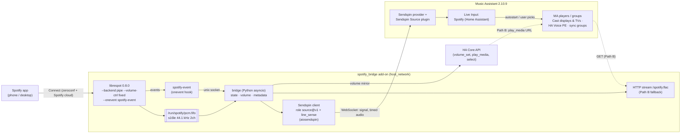

# Spotify Bridge: Implementation Plan

Companion to [DECISIONS.md](DECISIONS.md). The decision IDs (D1–D8) and risk IDs (R1–R8) refer to that document.
Date: 2026-11-12

## Architecture



What happens during a session (Path A):

1. You pick **Home Assistant** in the Spotify app. librespot starts a session, then fires `playing` and writes PCM to the FIFO.
2. The bridge reports `client/state source.signal = present`. MA's Sendspin Source plugin auto-starts the Live Input on its configured target and sends `server/command: start`.
3. The bridge streams timestamped PCM through `SourceCapture.feed()`. It drains and drops PCM while MA has not asked for audio, so librespot never blocks.
4. Spotify volume changes go to `media_player.volume_set` on the MA player that is playing the source (D6).
5. `paused`/`stopped` → `signal = absent`. MA keeps playing silence and stops the player after 1 min. Switching device in Spotify (`session_client_changed`/`session_disconnected`) does the same.

## Repository layout (target)

The upstream files keep their place, so upstream merges stay clean. Our additions are in **bold**.

```
ha-spotify-bridge/
├── **repository.yaml**                 # makes the repo installable as an HA add-on repository
├── README.md                           # rewritten: what the fork is, credit to upstream
├── **docs/** DECISIONS.md, PLAN.md, TESTING.md
├── spotify/  → renamed **spotify_bridge/**   (git mv, so history follows)
│   ├── config.yaml                     # slug spotify_bridge, homeassistant_api, no audio, new options
│   ├── build.yaml                      # unchanged base image
│   ├── Dockerfile                      # librespot features: native-tls with-libmdns (no pulse); + python3 venv
│   ├── DOCS.md / translations/en.yaml  # new options documented
│   └── rootfs/
│       ├── etc/services.d/librespot/run      # adds --backend pipe --device FIFO --format S16 --volume-ctrl fixed --onevent
│       ├── etc/services.d/librespot/finish   # unchanged
│       ├── **etc/services.d/bridge/{run,finish}**
│       └── **usr/bin/spotify-event**         # forwards PLAYER_EVENT + env to the bridge socket
└── **bridge/**                         # Python package, installed into the image venv
    ├── pyproject.toml                  # aiosendspin==10.3.*, aiohttp
    └── spotify_bridge/
        ├── __main__.py                 # load /data/options.json, start the services
        ├── config.py
        ├── events.py                   # unix-socket server, parses librespot events → state machine
        ├── pcm.py                      # FIFO reader; always drains; 44.1k s16 frames → listeners
        ├── sendspin_source.py          # aiosendspin client: source role, line_sense, pairing state in /data
        ├── http_stream.py              # Path B: aiohttp + ffmpeg FLAC fan-out
        ├── ha.py                       # Supervisor → Core API: volume_set, play_media, find active MA player
        └── tests/
```

## Phases

### Phase 0: Decide and de-risk (about 1 day, mostly hands-on in HA)

Goal: answer D1 and R1 before writing any code.

- [x] **R1, account check (PASS 2026-11-12, see TESTING.md):** start the *stock* Spotify Connect add-on for a moment and pick it in Spotify. The log must show a session and `playing` (audio goes nowhere, which is expected). Stop it again (start on boot stays off). If login fails, stop here: the answer is MA's plugin with Soloist.
- [ ] *(Optional, D1 is already decided)* Delay baseline: add MA's built-in **Spotify Connect** plugin with Connected players = Living Room Display, measure its delay, then remove it (R6).
- [x] **D2 spike (PASS 2026-11-12, see TESTING.md; delay not measured):** in a scratch Python venv on the PC, run an aiosendspin client with `source` + `line_sense`, feeding a test tone. Pair it in MA. Confirm it appears under Live Inputs and auto-starts on a chosen player when the signal goes `present`.
- [ ] Measure the end-to-end delay (click track) for the spike, and for MA's plugin as the baseline.
- [ ] Write the results in `docs/TESTING.md` and confirm or revise D1, D2 and D3.

**Exit criteria:** the account works with librespot, and the Sendspin source path is proven on this MA. (D1, D3, D5 and D8 were decided by the owner on 2026-11-12.)

### Phase 1: Fork and audio plumbing (about 2 days)

- [x] *(2026-11-12)* Fork on GitHub as `dnwk/ha-spotify-bridge` (public, D8). Clone it locally, add the `upstream` remote, and create the `bridge` branch. `git mv spotify spotify_bridge`. Add `repository.yaml`. Disable upstream's org-specific workflows.
- [ ] Dockerfile: change the librespot features and add python3 + venv + the bridge package. Build locally on the HA box (`/addons/local`) for amd64 first.
- [ ] librespot `run`: pipe backend to the FIFO, `--volume-ctrl fixed`, `--onevent`. Create the FIFO in the bridge's `run` before librespot starts.
- [ ] `spotify-event` hook + `events.py` state machine (idle / playing / paused / disconnected).
- [ ] `pcm.py`: FIFO reader that always drains (so librespot never blocks).
- [ ] **Demo:** Spotify → "Home Assistant" → the bridge logs PCM levels and state changes.

### Phase 2: Sendspin source into MA (about 3 days)

- [ ] `sendspin_source.py`: client hello with `source@v1` (PCM s16 44.1k stereo, FLAC optional), `line_sense: true`. Store the pairing and identity in `/data`. Reconnect with backoff.
- [ ] Map the state machine to `signal` present/absent. On `server/command: start`/`stop`, start or stop the capture. Feed timestamped PCM.
- [ ] Pairing instructions in DOCS.md. Option `sendspin_name`.
- [ ] Set the autostart target in MA (Living Room Display). Test moving the Live Input to another speaker and to a sync group by hand.
- [ ] **Demo:** Spotify → "Home Assistant" → plays on Living Room Display. Switch the speaker in MA without touching Spotify.

### Phase 3: Volume, metadata, fallback path (about 2 days)

- [ ] `ha.py`: find the MA player currently playing this source (MA entity attributes / `music_assistant.get_queue`). Mirror `volume_changed` (debounced) with `media_player.volume_set` (D6).
- [ ] Metadata: send track title/artist/cover from `track_changed` env vars, if MA's source path accepts it (otherwise defer).
- [ ] Path B `http_stream.py` + `output: media_player` option, for setups without MA.
- [ ] Unit tests: event parsing, state machine, config.

### Phase 4: HA speaker picker (about 1 day, optional for v1)

- [ ] Confirm HA can start an MA AudioSource on a chosen player (open question 4).
- [ ] Expose a `select.spotify_bridge_target` (via MQTT discovery, already available through Mosquitto) listing MA players. On change, move or start the Live Input on that player.

### Phase 5: Hardening and release (about 2 days)

- [ ] GitHub Actions: lint (upstream's yamllint/hadolint/shellcheck + ruff/pytest), `home-assistant/builder` multi-arch → GHCR (private), with cargo caching (R7).
- [ ] Soak test: 8 h playback, many device switches, MA restart and HA restart while playing.
- [ ] DOCS.md: setup, pairing, limits (R4, R5), credits and licences.
- [ ] Tag v0.1.0. Monthly upstream merge routine (R8).
- Optional later: switch to go-librespot for two-way control (D3), and a `devices:` list (D4).

## Test environment

- The test HA (HAOS 18.4 VM): needs the Samba or SSH add-on to copy into `/addons/local` (neither is installed today), or install from this repo once GHCR images exist.
- MA 2.10.9 with the Sendspin provider + Sendspin Source plugin (both already installed).
- Spotify Premium account (R1) and a phone with the Spotify app.
- Target speakers: a Nest Hub display (Cast), a Cast TV, an HA Voice PE (Sendspin).

## Effort summary

| Phase | Estimate | Outcome |
|---|---|---|
| 0 Decide | ~1 d | D1/R1 settled, Sendspin source proven |
| 1 Fork | ~2 d | librespot → FIFO + events in the bridge |
| 2 Sendspin | ~3 d | Spotify plays on any MA speaker |
| 3 Volume/fallback | ~2 d | Volume works, non-MA path |
| 4 HA picker | ~1 d | Speaker switch from dashboards |
| 5 Release | ~2 d | CI, images, docs, v0.1.0 |

## Immediate next step

All open questions are answered (2026-11-12). Run Phase 0: the stock add-on login check, then the Sendspin source spike. Both touch your HA/MA, so the exact steps are listed for the owner's OK before they run.
